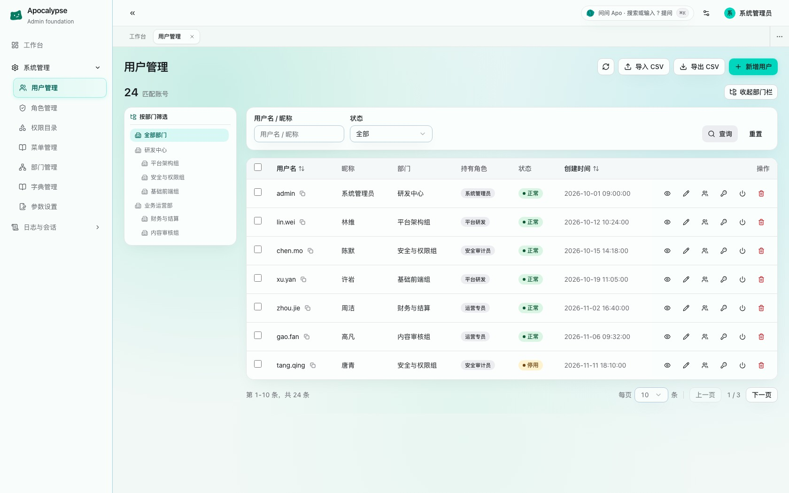
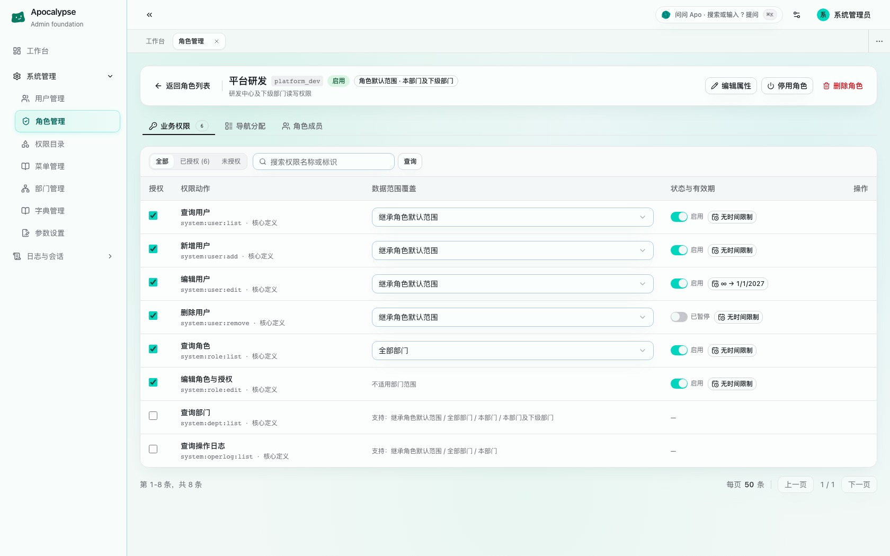

<picture>
  <source media="(max-width: 600px) and (prefers-color-scheme: dark)" srcset=".github/assets/readme/hero-mobile-dark.png">
  <source media="(max-width: 600px)" srcset=".github/assets/readme/hero-mobile-light.png">
  <source media="(prefers-color-scheme: dark)" srcset=".github/assets/readme/hero-dark.png">
  
</picture>

<p align="center">
  <strong>Java 25 / Spring Boot 4.1 模块化单体 × React 19 管理台基座</strong><br>
  含认证授权、实时权限判定、操作审计、两级缓存与标准化后台页面组件。
</p>

<p align="center">
  <a href="docs/release.md"></a>
  <a href="https://github.com/lilibonk/apocalypse/actions/workflows/ci.yml"></a>
  <a href="LICENSE"></a>
</p>

<p align="center">
  <a href="docs/getting-started.md"><strong>快速开始</strong></a> ·
  <a href="#界面预览">界面预览</a> ·
  <a href="docs/module-development.md">模块开发</a> ·
  <a href="docs/README.md">文档索引</a> ·
  <a href="CHANGELOG.md">变更记录</a>
</p>

## 界面预览

管理台包含用户、角色、权限目录、菜单、部门、字典与参数工作区，支持清透流体、手绘手账与深邃夜色（Obsidian）三套主题，以及中英文、两档密度与响应式布局。

<picture>
  <source media="(prefers-color-scheme: dark)" srcset=".github/assets/readme/admin-dark.jpg">
  
</picture>

<p align="center"><sub>用户管理工作区（清透流体亮色 / Obsidian 暗色 · 示例数据）</sub></p>

<details>
<summary><strong>角色授权工作台：业务权限、数据范围与导航分配</strong></summary>

角色配置在同一路由全宽展开，统一编辑业务权限开关、逐权限数据范围覆盖、UTC 生效起止时间、C/M 导航菜单分配以及角色成员基线，保存时校验服务端修订号。

<picture>
  <source media="(prefers-color-scheme: dark)" srcset=".github/assets/readme/role-workbench-dark.jpg">
  
</picture>

</details>

<details>
<summary><strong>登录页与三主题世界切换</strong></summary>

登录页左侧为 Apo / Milk Cloud 角色舞台（支持 WebGPU 交互并在关闭动效或不支持时降级为静态形象），右侧为凭证表单以及底部的主题世界与语言切换控制。

<picture>
  <source media="(prefers-color-scheme: dark)" srcset=".github/assets/readme/login-dark.jpg">
  
</picture>

</details>

## 结构与取向

### 单 Maven 模块下的物理边界

后端保持单 Maven 模块构建，以 `io.apocalypse.<domain>` 划分业务域，`common` 与 `framework` 承担共享契约和基础设施装配。跨模块调用仅允许通过对方 `api` 包 facade 或 `common.event` 事件，边界规则由 Spring Modulith 与 ArchUnit 在构建阶段检查。

### 独立业务授权与数据范围

业务权限（`sys_permission` / `sys_role_permission`）与菜单导航（`sys_menu` / `sys_role_navigation`）彻底分离：新增或调整菜单不会授予任何接口能力，后端每个 `@PreAuthorize` 经统一 factory 对角色范围（`ALL` / `DEPT` / `DEPT_AND_CHILDREN`）、逐权限范围覆盖、生效有效期及请求级授权快照实时判定。

### 统一的前端工作区与门禁

后台页面围绕无头 `useDynaController`、`DynaPage`、`DynaPagination` 与实体速览组件 `EntityPeekLink` 构建，配合 `/profile` 自助资料、密码与在线会话管理。前后端在 CI 中分别执行 `./mvnw --batch-mode verify`（ArchUnit、Modulith、Flyway 与 Testcontainers 集成测试）与 `pnpm check` / `pnpm test:browser`（Vitest 与 Chromium 浏览器交互测试）。

## 内置能力

| 领域       | 包含内容                                                                                 |
| ---------- | ---------------------------------------------------------------------------------------- |
| 系统管理   | 用户（CSV 导入导出、部门过滤）、角色与授权工作台、权限目录、菜单与部门分页树、字典色卡、参数批量编辑、在线会话与通用文件管理 |
| 数据权限   | 角色默认与逐权限 `ALL` / `DEPT` / `DEPT_AND_CHILDREN` 范围、UTC 固定有效期、用户归属对象校验 |
| 认证与安全 | 内存 access JWT、同源 HttpOnly/Secure refresh Cookie 轮转、CSRF、IP/账号登录锁定与接口限流 |
| 审计与可观测 | 事件驱动登录/操作日志、敏感字段脱敏、TraceId 透传、OpenAPI（仅开发态）与健康检查         |
| 数据与缓存 | MyBatis-Plus 3.5、Flyway（`V1.x` 平台 / `V100.x+` 业务隔离）、PostgreSQL、Redis + Caffeine 两级缓存 |
| 前端管理台 | 三套主题世界（`fluid` / `sketchbook` / `obsidian`）、中英文、命令面板、多页签与 `/profile` 个人中心 |
| 可选模块   | Calendar 试验域：默认关闭，通过配置开关统一控制暴露面与授权状态                          |

<details>
<summary><strong>技术栈与目录结构</strong></summary>

| 后端                                            | 前端                                    |
| ----------------------------------------------- | --------------------------------------- |
| Java 25 · Spring Boot 4.1.1 · Spring Modulith 2.1 | React 19 · TypeScript · Vite 7          |
| Spring Security · MyBatis-Plus 3.5 · Flyway     | Tailwind CSS 4 · shadcn/ui · Radix UI   |
| PostgreSQL 18.6 · Redis 8.10.1 · Caffeine       | TanStack Query · Zustand · React Router |
| ArchUnit · Testcontainers                       | Vitest · Playwright                     |

```text
src/main/java/io/apocalypse/
├── common/             共享响应、异常与跨模块事件契约
├── framework/          安全、缓存、Web 与模块装配基础设施
├── system/             系统管理业务域（用户/角色/权限/菜单/部门/字典/参数/日志）
└── calendar/           可选万年历业务域

apocalypse-web/src/
├── components/         布局骨架、DynaLayer 与通用组件
├── design/             设计规范（DEFINITION.md / MOTION.md）与主题变量
├── lib/                API 客户端、授权快照生命周期与路由辅助
└── views/              按业务域划分的页面实现
```

</details>

## 本地运行

需要 **JDK 25、Docker Compose、Node.js 24、pnpm 11.19.0**（Maven 通过 `./mvnw` 随仓库提供）。

```bash
git clone https://github.com/lilibonk/apocalypse.git
cd apocalypse
```

按[快速开始](docs/getting-started.md#1-准备本地服务和一次性管理员密码)在当前 shell 设置本地 JWT 签名密钥与一次性管理员密码后，启动依赖与后端：

```bash
docker compose up -d
./mvnw spring-boot:run
```

另开终端启动前端：

```bash
cd apocalypse-web
pnpm install --frozen-lockfile
pnpm dev
```

打开 [http://localhost:5173](http://localhost:5173) 使用 `admin` 和设置的密码登录；首次初始化完成后请及时移除一次性密码环境变量。更多环境细节见[快速开始](docs/getting-started.md)。

> 空库自动执行 `V1__init.sql` 与 `V1_1__sys_file_storage.sql` 平台基线；平台级迁移固定在 `V1.x`，下游业务模块迁移固定在 `V100.x+`。涉及版本升级或数据库恢复时，需先停止全部旧实例、使用全新 JWT 签名密钥重新签发凭据，并成对备份与恢复数据库及文件存储目录。

## 开发与验证

参考[模块开发指南](docs/module-development.md)划分新业务域，可使用 `scripts/create-module.mjs` 脚手架生成模块基础结构；标准列表优先复用 DynaLayer 与通用控制器，复杂交互保持域内独立实现。

```bash
# 仓库根目录：完整后端门禁（单测、架构校验、Testcontainers 集成测试、格式化检查）
./mvnw --batch-mode verify

# 仓库根目录：校验公开文档内部链接
node scripts/verify-public-docs.mjs

# 前端目录：格式、lint、单测、构建与 Chromium 浏览器交互测试
cd apocalypse-web
pnpm check
pnpm test:browser
```

| 目标               | 文档                                                                          |
| ------------------ | ----------------------------------------------------------------------------- |
| 本地安装与故障排查 | [快速开始](docs/getting-started.md)                                           |
| 扩展新业务模块     | [模块开发](docs/module-development.md) · [前端说明](apocalypse-web/README.md) |
| 部署、备份与升级   | [部署指南](docs/deployment.md) · [运行与升级](docs/operations.md)             |
| 启用 Calendar      | [Calendar 手册](docs/calendar/README.md)                                      |
| 查看边界与兼容政策 | [发行契约](docs/release.md) · [变更记录](CHANGELOG.md)                        |

## 版本状态与许可

当前版本为 **`0.1.0` 正式版**，发行归档与校验信息见 [GitHub Release](https://github.com/lilibonk/apocalypse/releases/tag/v0.1.0) 与[发行契约](docs/release.md)。

本版本不包含代码生成器、在线任务调度管理平台、公告与多租户；通用文件管理与单实例受控 SSE 实时通道已随首版纳入。Calendar 为默认关闭的可选试验域；早期 Order 运行接口已退役，仅保留兼容表结构与事件桥。

项目自有代码按 [Apache License 2.0](LICENSE) 分发；移植代码、素材与运行时依赖的原始许可见[第三方声明](THIRD_PARTY_NOTICES.md)。
